# Publications périodiques : guide d'utilisation

_Periodical_ (affiché **Publications périodiques** dans l'administration) est un plugin pour
[Dotclear](https://dotclear.org) qui publie vos billets tout seul, à intervalles réguliers. Vous écrivez
plusieurs billets d'avance, vous les rangez dans une **période** (par exemple « un billet par semaine »), et le
plugin les publie les uns après les autres.

* [Installation et permissions](#installation-et-permissions)
* [Les réglages du blog](#les-réglages-du-blog)
* [Comment ça marche](#comment-ça-marche)
* [Les périodes](#les-périodes)
* [Créer ou modifier une période](#créer-ou-modifier-une-période)
* [Mettre des billets dans une période](#mettre-des-billets-dans-une-période)
* [Les billets d'une période](#les-billets-dune-période)
* [La publication automatique](#la-publication-automatique)
* [Colonnes et options d'affichage](#colonnes-et-options-daffichage)
* [Le tableau de bord](#le-tableau-de-bord)
* [Autres plugins](#autres-plugins)
* [Désinstallation](#désinstallation)

## Installation et permissions

Le plugin demande Dotclear 2.39 et PHP 8.1 ou plus récent. Installez-le comme n'importe quel plugin, depuis la
page _Plugins_ de l'administration.

Le plugin crée sa propre table dans la base de données pour ranger les périodes.

Il faut être **administrateur** du blog pour modifier les réglages du plugin, et avoir la permission
**« gérer tout le contenu »** (_content admin_) pour gérer les périodes.

## Les réglages du blog

Les réglages se trouvent dans _Blog › Paramètres du blog_, dans la section **Paramètres des plugins pour ce blog**,
sous le titre _Publications périodiques_. Chaque blog a ses propres réglages.

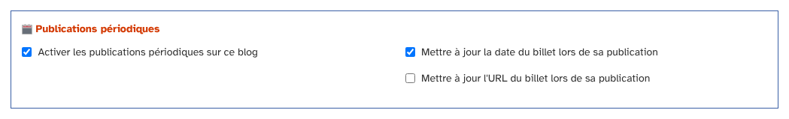

* **Activer les publications périodiques sur ce blog** : tant que cette case n'est pas cochée, rien n'est publié
  et le plugin reste discret : le menu _Publications périodiques_, l'option dans les billets et les actions
  groupées n'apparaissent pas.
* **Mettre à jour la date du billet lors de sa publication** : le billet prend la date prévue de la mise à jour
  de sa période, et non la date à laquelle vous l'aviez écrit. Cette case est cochée par défaut.
* **Mettre à jour l'URL du billet lors de sa publication** : si votre adresse de billet contient la date,
  elle est recalculée avec la nouvelle date. Cette case n'est pas cochée par défaut.

N'oubliez pas d'enregistrer les paramètres du blog.

## Comment ça marche

Une **période** a un titre, une date de début, une date de fin, une fréquence (toutes les heures, une fois par
jour, une fois par semaine…) et un nombre de billets à publier à chaque fois.

Vous **ajoutez des billets** à une période. Ces billets doivent avoir l'état **En attente** : ce sont les seuls que
le plugin publie.

Ensuite, vous n'avez plus rien à faire. Quand l'heure d'une mise à jour est passée, le plugin publie le ou les
billets suivants de la période. Un billet publié sort de la période.

Le plugin n'a pas de tâche planifiée : il vérifie les périodes quand **un visiteur ouvre la page d'accueil du
blog ou un de ses flux** (Atom ou RSS). Si personne ne passe, rien n'est publié avant la prochaine visite.
Voir [La publication automatique](#la-publication-automatique).

## Les périodes

La liste des périodes se trouve dans le menu _Plugins_, sous le nom **Publications périodiques**.

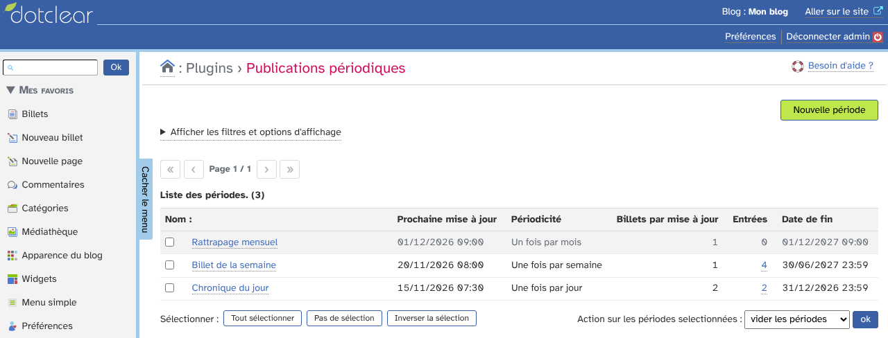

Pour chaque période, la liste indique :

* le **nom** : cliquez dessus pour modifier la période ;
* la **prochaine mise à jour** : la date du prochain tour de publication ;
* la **périodicité** : toutes les heures, deux fois par jour, une fois par jour, une fois par semaine ou une fois
  par mois ;
* le nombre de **billets par mise à jour** ;
* les **entrées** : le nombre de billets qui attendent dans cette période. Cliquez sur le nombre pour voir
  ces billets ;
* la **date de fin** : après cette date, la période ne publie plus rien.

Le bouton **Nouvelle période** crée une période.

### Filtrer et trier

Cliquez sur _Afficher les filtres et options d'affichage_ pour choisir le tri (par prochaine mise à jour, par date
de fin ou par fréquence), l'ordre et le nombre de périodes par page.

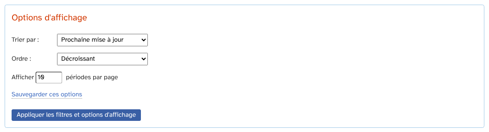

### Vider ou effacer des périodes

Cochez une ou plusieurs périodes, puis choisissez une action en bas de la liste :

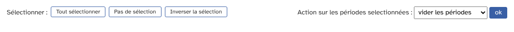

* **vider les périodes** : retire tous les billets de la période, qui reste en place ;
* **effacer les périodes** : retire les billets, puis supprime la période.

Dans les deux cas, **les billets ne sont pas supprimés** : ils sont seulement retirés de la période et gardent
leur état « En attente ».

## Créer ou modifier une période

Cliquez sur _Nouvelle période_, ou sur le nom d'une période de la liste.

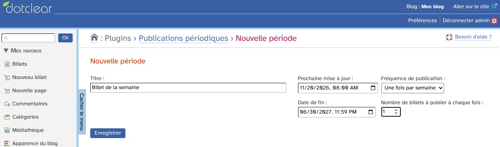

* **Titre** : le nom de la période. Deux périodes ne peuvent pas avoir le même titre.
* **Prochaine mise à jour** : la date et l'heure du prochain tour de publication. Pour une nouvelle période, le
  formulaire propose la date du moment.
* **Date de fin** : après cette date, la période est ignorée. Elle doit être plus tardive que la prochaine mise
  à jour. Pour une nouvelle période, le formulaire propose la date du jour dans un an.
* **Fréquence de publication** : toutes les heures, deux fois par jour (toutes les 12 heures), une fois par
  jour, une fois par semaine ou une fois par mois.
* **Nombre de billets à publier à chaque fois** : de 1 à 20.

Les dates sont dans votre fuseau horaire. Cliquez sur **Enregistrer**.

Pour une nouvelle période, le formulaire est prérempli avec le titre « Un billet par jour », une publication
une fois par jour et un billet à chaque fois. Changez ce que vous voulez avant d'enregistrer.

## Mettre des billets dans une période

Il y a trois façons de mettre un billet dans une période. Un billet ne peut être que dans une seule période à
la fois : le mettre dans une autre le retire de la première. Si vous n'avez encore créé aucune période, les choix
ne sont pas proposés.

### Depuis le billet

Dans la page d'un billet, la colonne de droite a une rubrique **Période** (dans le bloc _Options_). Cliquez sur
la flèche pour l'ouvrir, choisissez la période, puis enregistrez le billet. Choisissez « - » pour retirer le
billet de sa période.

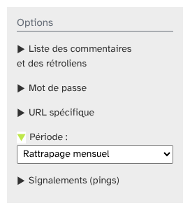

N'oubliez pas de mettre le billet à l'état **En attente** : sinon la période ne le publiera pas.

### Avec une action groupée

Dans la liste des billets, cochez plusieurs billets, puis choisissez l'action **Ajouter aux publications
périodiques** (dans le groupe _Publications périodiques_) et cliquez sur _ok_.

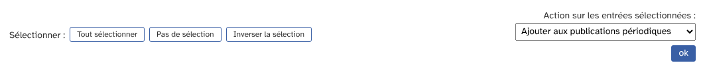

Une page vous demande alors de choisir la période, puis cliquez sur **Enregistrer**.

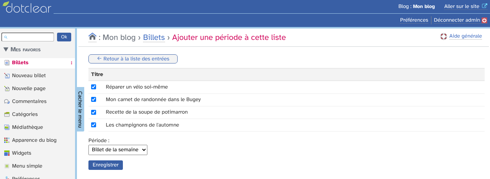

L'action **Retirer des publications périodiques** fait l'inverse : elle retire les billets cochés de leur
période, sans les modifier. Elle est réservée aux personnes qui peuvent supprimer des billets ou gérer tout le contenu.

### Voir les périodes dans la liste des billets

La liste des billets a une colonne **Période**, qui indique la période de chaque billet. Cliquez sur le nom pour
modifier la période.

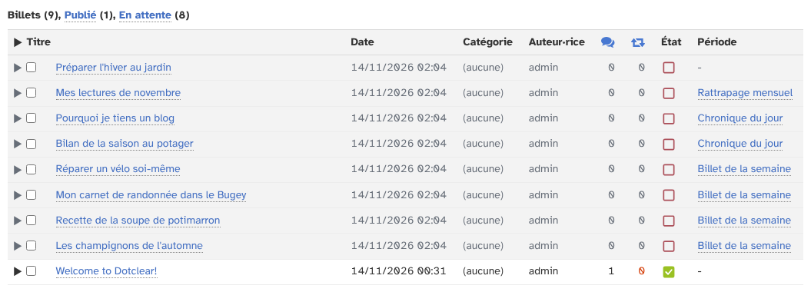

## Les billets d'une période

Pour voir les billets d'une période, cliquez sur le nombre d'entrées dans la liste des périodes, ou ouvrez la
période. Sous le formulaire, le bloc **Billets liés à cette période** liste les billets qui l'attendent. Il
a les mêmes filtres que la liste des billets.

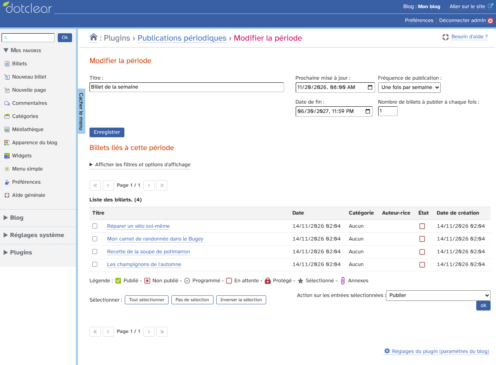

Cochez des billets, puis choisissez une action en bas de la liste :

* **Publier** : publie tout de suite les billets cochés, sans attendre la prochaine mise à jour, puis les retire
  de la période ;
* **Retirer** : met les billets cochés hors ligne (état « Non publié »), puis les retire de la période ;
* **Retirer des publications périodiques** : retire simplement les billets de la période, sans changer leur
  état.

## La publication automatique

Voici ce que fait le plugin quand un visiteur ouvre la page d'accueil du blog ou un flux.

1. Il regarde chaque période **en cours** : sa prochaine mise à jour est passée et sa date de fin ne l'est pas.
2. Il compte combien de tours de publication sont dus depuis la dernière fois.
3. Il publie, **dans l'ordre de leur date**, du plus ancien au plus récent, autant de billets **en attente** que
   nécessaire : le nombre de billets par mise à jour multiplié par le nombre de tours dus.
4. Si l'option est cochée dans les réglages, chaque billet reçoit la **date prévue** du tour de publication et
   non l'heure de la visite. Quand plusieurs billets sont publiés d'un coup pour rattraper du retard, ils
   reçoivent des dates échelonnées.
5. Chaque billet publié **sort de la période**.
6. La **prochaine mise à jour** de la période avance à la prochaine date de la série qui est dans le futur.

Quelques conséquences à connaître :

* si la période n'a plus de billet, la prochaine mise à jour avance quand même : rien n'est perdu quand vous
  ajoutez des billets plus tard ;
* seuls les billets à l'état **En attente** sont publiés. Un billet « Non publié » ou « Programmé » reste dans la
  période, mais elle ne le publie pas ;
* une période dont la date de fin est passée ne publie plus rien. Les billets restent en attente : changez la date
  de fin pour relancer la période ;
* si le blog est peu visité, la publication peut avoir du retard. Les billets sont alors publiés d'un coup à la
  visite suivante, avec leurs dates échelonnées.

Si vous supprimez un billet, il est aussi retiré de sa période.

## Colonnes et options d'affichage

Dans _Préférences › Mes options_, la rubrique **Colonnes optionnelles affichées dans les listes** a un bloc
_Publications périodiques_ : il permet de choisir les colonnes de la liste des périodes (prochaine mise à jour,
périodicité, billets par mise à jour, entrées, date de fin).

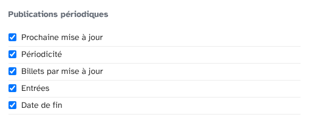

La colonne _Période_ de la liste des billets se règle dans le bloc _Billets_ de la même rubrique.

Plus bas, la rubrique **Options des listes** règle le tri, l'ordre et le nombre de périodes par page de la
liste des périodes. Ce sont les mêmes options que dans les filtres de la liste.

## Le tableau de bord

Pour retrouver le plugin sur la page d'accueil de l'administration, ajoutez-le à vos favoris dans
_Préférences › Mes favoris_ : cochez **Publications périodiques**, puis cliquez sur _Ajouter à mes favoris_.

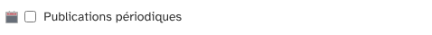

Son icône apparaît alors sur le tableau de bord.

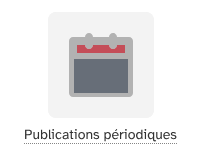

## Autres plugins

Avec le plugin [ClaudetteMcp](https://github.com/JcDenis/ClaudetteMcp), un assistant IA connecté au blog dispose
de deux outils de plus : l'un liste les périodes, l'autre met un billet dans une période ou l'en retire.
_ClaudetteMcp_ n'est pas nécessaire au fonctionnement de _Periodical_.

## Désinstallation

Depuis la page _Plugins_, le bouton _Désinstaller_ permet de supprimer les réglages du plugin, sa table (donc
toutes les périodes), puis le plugin lui-même. Les billets ne sont pas touchés.
